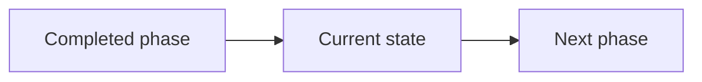

# Roadmap Briefing

At the end of each completed phase, report in Persian in this compact form:

Then include:
- **انجام شد:** up to 3 concrete bullets, with file links when useful.
- **بررسی:** exact commands/checks and pass/fail/not-run.
- **مسدودکننده/ریسک:** only evidence-backed issues.
- **گام بعد:** one roadmap phase; wait for user’s «برو بعدی» before implementing it.

Do not claim three agents ran unless tool evidence shows real delegation. Distinguish sequential review passes from independent agents. No generic claims such as «بدون باگ» or «امنیت ۱۰۰٪».
